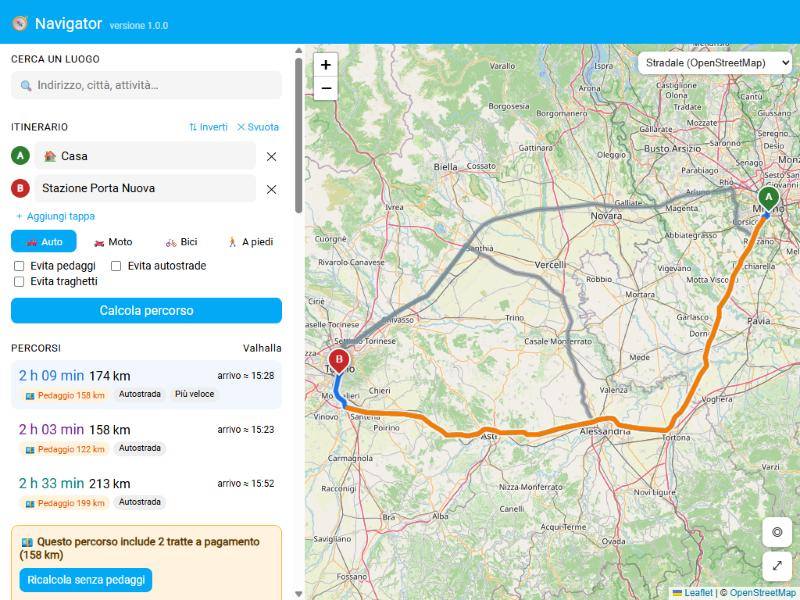
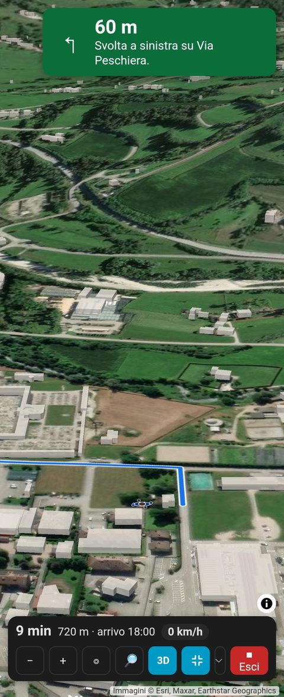
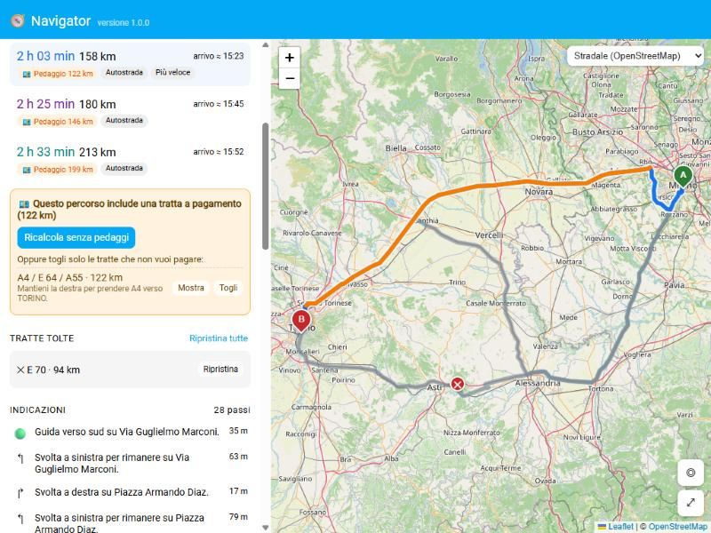
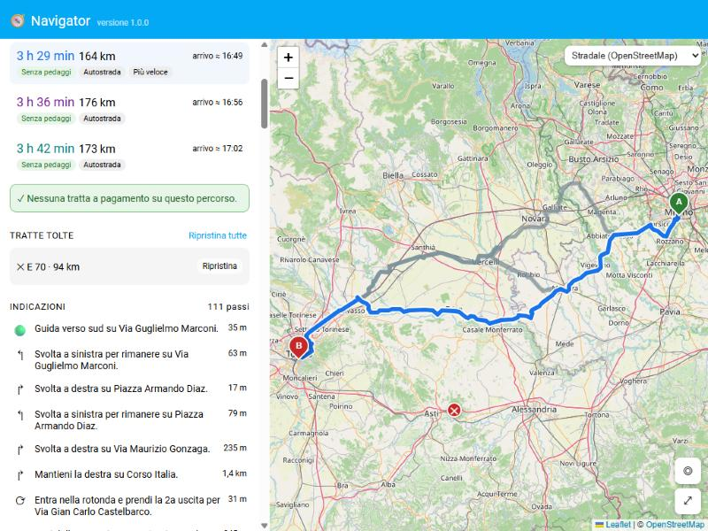

<p align="center"></p>

# Navigator per Home Assistant

**Mappe, ricerca di destinazioni e itinerari nella barra laterale di Home Assistant**, con servizi online **gratuiti e senza chiave** basati su OpenStreetMap.

Cerca un indirizzo o un'attività, imposta partenza, tappe e destinazione e calcola il percorso in auto, moto, bici o a piedi. Se il percorso usa **tratte a pagamento** Navigator te le mostra sulla mappa e puoi **toglierle tutte** con un clic oppure **solo quelle che non vuoi pagare**, e il percorso viene ricalcolato.



### Novità: guida in 3D

Con il tasto **3D** la mappa si inclina e mostra il **rilievo del terreno** e gli **edifici in 3D**; in guida gira nella direzione di
marcia e ti segue. Con **▲ / ▼** scegli la prospettiva, dalla vista dall'alto fino a quasi la telecamera dell'auto.

<p align="center"></p>

## Funzioni

- **Pannello "Navigator" nella barra laterale**, a tutta pagina, anche da telefono (app Companion).
- **Ricerca** di indirizzi, città, attività e punti d'interesse con suggerimenti mentre scrivi.
- **Itinerario** con partenza, destinazione e fino a 10 tappe intermedie: riordina, inverti, trascina i segnaposto sulla mappa.
- Punti rapidi: **Casa** (posizione di Home Assistant), **la mia posizione** (GPS del dispositivo), zone e persone di Home Assistant, **preferiti** e **destinazioni recenti**.
- Clic sulla mappa: *Parti da qui*, *Aggiungi tappa*, *Arriva qui*, *Salva nei preferiti*.
- Mezzo: **auto, moto, bici, a piedi**. Opzioni: evita pedaggi, autostrade, traghetti.
- Fino a **3 percorsi alternativi** con durata, distanza, orario di arrivo stimato e chilometri a pagamento.
- **Frecce del verso di marcia** sul percorso scelto (in 2D e in 3D): nelle rotonde e nei sensi unici si vede subito da che parte si va.
  In guida la parte già percorsa diventa **grigia e chiara** (senza frecce): davanti resta solo la strada da fare.
- **Pedaggi**:
  - le tratte a pagamento sono evidenziate in arancione sulla mappa ed elencate con nome (A4, A21…) e lunghezza;
  - **Ricalcola senza pedaggi**: Navigator evita le strade a pagamento e, se il server ne usa ancora qualcuna, la esclude e ricalcola finché il percorso è gratuito;
  - **Togli** una singola tratta: il percorso viene ricalcolato senza quella tratta (segnata con ✕ sulla mappa); le tratte tolte si possono ripristinare.
- **Indicazioni passo passo** in italiano: clic su un passo per vederlo sulla mappa.
- **Navigazione** con la tua posizione: la mappa ti segue, in alto vedi la prossima manovra e la distanza, in basso tempo e km rimanenti e l'orario di arrivo. Se esci dal percorso per qualche secondo compare il popup **"Ricalcolo del percorso…"** e Navigator rifà la strada da dove sei (con le stesse opzioni: pedaggi, tratte tolte, tappe ancora da raggiungere).
- Apri il percorso in **Google Maps**, **Waze** o **OpenStreetMap**, oppure copia il riepilogo.
- Mappe gratuite senza chiave: stradale, topografica, scura e satellite (Esri), escursionistica (OpenTopoMap).
- **Vista 3D** con rilievo del terreno ed edifici, anche in guida, con la prospettiva regolabile ([dettagli](#vista-3d)).
- Servizio **`navigator.plan_route`** per le automazioni (tempo di viaggio, distanza, pedaggi).

| Togli una tratta a pagamento | Ricalcola senza pedaggi |
| --- | --- |
|  |  |

## Installazione

### HACS (repository personalizzato)

[](https://my.home-assistant.io/redirect/hacs_repository/?owner=LabirintoDigitale&repository=ha-navigator&category=integration)

1. HACS → ⋮ → **Repository personalizzati** → aggiungi `https://github.com/LabirintoDigitale/ha-navigator` come **Integrazione**
2. Installa **Navigator** e **riavvia Home Assistant**
3. Impostazioni → Dispositivi e servizi → **Aggiungi integrazione** → **Navigator**

Nella barra laterale compare **Navigator** con l'icona della rosa dei venti.

### Manuale

Copia la cartella `custom_components/navigator` nella cartella `config/custom_components/` di Home Assistant, riavvia e aggiungi l'integrazione.

## Servizi usati

Tutte le richieste partono da Home Assistant (nessuna chiave, nessun account):

| A cosa serve | Servizio | Note |
| --- | --- | --- |
| Percorsi | [Valhalla](https://github.com/valhalla/valhalla) su `valhalla1.openstreetmap.de` (FOSSGIS) | istruzioni in italiano, pedaggi, alternative |
| Percorsi (riserva) | [OSRM](https://project-osrm.org/) su `routing.openstreetmap.de` (FOSSGIS) | usato solo se Valhalla non risponde; senza opzioni "evita" |
| Ricerca | [Photon](https://photon.komoot.io) (komoot) | suggerimenti mentre scrivi |
| Ricerca e indirizzi (riserva) | [Nominatim](https://nominatim.org) di OpenStreetMap | max 1 richiesta al secondo |
| Distributori (Italia) | [Anagrafica impianti attivi del MIMIT](https://www.mimit.gov.it/images/exportCSV/anagrafica_impianti_attivi.csv) | una volta al giorno, con la marca |
| Carburanti e prezzi (Italia) | [Prezzi alle 8 del MIMIT](https://www.mimit.gov.it/images/exportCSV/prezzo_alle_8.csv) | due volte al giorno |
| Autovelox fissi, parcheggi | OpenStreetMap tramite [Overpass](https://overpass-api.de) | autovelox una volta alla settimana, parcheggi su richiesta |
| Mappe | Esri (stradale, topografica, scura, satellite), OpenTopoMap | caricate dal browser; i server di OpenStreetMap bloccano le richieste da un Home Assistant in rete locale |
| Rilievo (vista 3D) | Quote del terreno [Mapzen/Tilezen Terrarium](https://registry.opendata.aws/terrain-tiles/) (AWS Open Data) | caricate dal browser, solo in 3D |
| Edifici 3D, gallerie | [OpenFreeMap](https://openfreemap.org) (dati OpenStreetMap, schema OpenMapTiles) | caricati dal browser, solo in 3D |

Sono servizi gratuiti offerti dalla comunità con limiti d'uso "ragionevole": Navigator è pensato per l'uso personale.
Nelle **opzioni dell'integrazione** puoi indicare i tuoi server Valhalla, OSRM, Photon o Nominatim.

## Servizio `navigator.plan_route`

Restituisce durata e distanza di un percorso, utile nelle automazioni (es. "quanto ci metto per andare al lavoro?").
`origin`, `destination` e `via` accettano un indirizzo, coordinate `lat,lon` o un'entità (`zone.home`, `person.mario`, `device_tracker.telefono`).

```yaml
action: navigator.plan_route
data:
  origin: person.mario
  destination: "Piazza Castello, Torino"
  mode: auto
  avoid_tolls: true
response_variable: percorso
```

Risposta: `duration_min`, `distance_km`, `has_toll`, `toll_km`, `has_highway`, `has_ferry`, `instructions`, `warnings`.

## Navigazione e posizione

Dopo aver calcolato un percorso, nella sezione **Navigazione** scegli da dove prendere la posizione e premi **Parti**. La stessa scelta vale per ◎ *La mia posizione*, che mostra il **veicolo** del mezzo scelto in quel punto, (anche prima di partire e come partenza "La mia posizione"); il link *📱 Mostra la posizione di questo dispositivo* mette un segnaposto grigio sul GPS (o sulla posizione stimata dal browser) del dispositivo che stai usando. Accanto a persone e dispositivi il menu dice da quanto è arrivata la loro ultima posizione; se è più vecchia di 10 minuti, **Parti** avvisa prima di partire:

- **GPS di questo dispositivo**: il più preciso, ma il browser lo concede solo se Home Assistant è aperto in **HTTPS**.
  Si può scegliere anche nell'**app Companion per Android**, che però spesso non passa il GPS alle pagine anche con tutte le autorizzazioni
  concesse: lì Navigator parte di norma dalla tua persona e, se il GPS non risponde, propone di usarla.
- **Una persona o un dispositivo di Home Assistant** (`person.…`, `device_tracker.…`): la posizione inviata dall'**app Companion**, funziona anche in http.
  Per aggiornamenti ogni pochi secondi attiva nell'app *Impostazioni → App Companion → Gestisci sensori → Posizione in background → Modalità alta precisione*.

Con un percorso calcolato premi **▶ Parti** (sulla mappa o nella sezione *Navigazione*): la mappa passa a tutto schermo e
**ruota con la direzione di marcia** (avanti è sempre in alto, la destra è la destra del veicolo). Il veicolo, visto dall'alto,
cambia col mezzo scelto (fuoristrada, moto, bicicletta o persona a piedi) e sta nel terzo basso dello schermo per vedere la strada davanti.

La **barra in basso** contiene tutto: tempo, km e orario di arrivo e, sotto, **−** e **+** (zoom), **◎** (centra sulla tua
posizione), il **tipo di mappa** (stradale, topografica, scura, satellite, escursionistica) e **■ Esci**, che chiude la
navigazione e torna alla vista normale. La mappa si può anche trascinare col mouse o con un dito e ingrandire con due dita:
in quel caso smette di seguirti finché non premi **◎**.

### Nelle vicinanze: distributori, parcheggi, autovelox

Con un percorso calcolato, la sezione **Nelle vicinanze** del pannello (e in guida il tasto **🔎** nella barra) apre l'elenco:

- **⛽ Distributori** lungo il percorso (in guida: i prossimi 40 km), entro 500 m dalla strada, in ordine di distanza, con la
  **marca** (Agip Eni, Api-Ip, Q8, Esso, Tamoil, Shell, pompe bianche…) e il filtro **★ Preferite** (marche scelte in ⚙).
  **➕ Tappa** aggiunge il distributore al percorso e lo ricalcola. In Italia l'elenco viene dall'**anagrafica ufficiale degli
  impianti attivi del MIMIT** (dati aperti Osservaprezzi), scaricata una volta al giorno; altrove da OpenStreetMap.
  Per ogni distributore ci sono i **carburanti venduti con il prezzo** (self, o servito se c'è solo quello), dal file
  *prezzo alle 8* del MIMIT scaricato due volte al giorno: i prezzi comunicati più di 7 giorni prima sono segnati in arancione.
  Il filtro per **carburante** (Benzina, Gasolio, Benzina speciale, **100 ottani**, Gasolio speciale, GPL, Metano, GNL) mostra solo
  gli impianti che lo vendono e permette di ordinarli per **prezzo più basso**; il carburante preferito si sceglie in ⚙.
  I nomi dei prodotti sono quelli commerciali comunicati dai gestori: "100 ottani" comprende quelli con *100* nel nome.
  Fuori dall'Italia i carburanti vengono dai tag di OpenStreetMap, senza prezzi.
- **🅿️ Parcheggi** pubblici entro 700 m dall'arrivo (o, in guida, vicino a te), con coperto / a pagamento / posti quando noti.
  **🅿️ Vai qui** imposta il parcheggio come arrivo. Fonte: OpenStreetMap (Overpass); se i server non rispondono, i parcheggi con
  un nome trovati con Photon.
- **📷 Autovelox fissi** sul percorso, da OpenStreetMap (tutta Italia, aggiornati una volta alla settimana). In guida compare
  il cartello "📷 distanza · limite" a 600 m (1 km sopra i 90 km/h) e, se attivi, l'avviso a voce e un doppio beep; quelli
  orientati verso l'altra carreggiata vengono ignorati.

> Gli autovelox **mobili** non ci sono: non esiste una banca dati libera e aggiornata (le app che li mostrano usano dati
> propri o a pagamento).

I dati scaricati restano in `config/navigator_cache/`.

### Vista 3D

Il tasto **3D** (sulla mappa e nella barra della guida) inclina la mappa e mostra il **rilievo del terreno**, con le ombre sui
versanti, e gli **edifici in 3D** da vicino (con l'altezza dove è mappata in OpenStreetMap). Sopra il rilievo resta la mappa scelta
(stradale, satellite, topografica…), con percorso, tappe, distributori e veicolo. In guida la vista è inclinata, gira nella direzione
di marcia e ti segue; con due dita si può girare e inclinare, trascinando smette di seguirti fino a **Ricentra**.
I tasti **▲ / ▼** in alto a destra cambiano la prospettiva a passi di 15°: da 0° (mappa vista dall'alto) fino a 80°, quasi come
una telecamera sul cruscotto; l'inclinazione scelta resta anche per le volte successive.
In guida anche la **distanza** dalla macchina si regola e resta memorizzata: con le dita, con la rotella o con **+ / −**
(anche il gesto con due dita per inclinare viene ricordato); lo zoom con le dita non smette di seguirti, solo il trascinamento
sì. **◎** torna sulla posizione mantenendo la distanza scelta; premuto **due volte di seguito** rimette quella predefinita. Se una collina o la montagna alle
spalle finirebbe davanti alla telecamera, Navigator abbassa l'inclinazione quanto basta (la vista resta sopra il terreno e
vicina alla macchina; quando la valle si apre torna quella scelta); **◎** rimette lo zoom automatico. Premuto di nuovo,
**3D** torna alla mappa piatta; la scelta resta per le volte successive.

- Usa la grafica del telefono (WebGL) e scarica anche le quote del terreno: consuma più batteria e dati della mappa piatta.
- In ⚙ si sceglie quanto accentuare il rilievo e lo **stile degli edifici**: *Colorati* (bassi chiari, alti azzurri, con chiari e scuri
  sulle facciate), *Con finestre* (facciate chiare con finestre distanziate, tetti pieni) o *Semplici*; gli edifici si possono anche togliere.
- La libreria 3D ([MapLibre GL JS](https://maplibre.org)) è inclusa in `frontend/maplibre` e si carica solo alla prima pressione di **3D**.

### Gallerie

Con la vista 3D attiva Navigator riconosce le **gallerie** sul percorso (strade in galleria di OpenStreetMap, dalle mappe di
OpenFreeMap, man mano che la zona si carica): sulla mappa quei tratti sono **grigi a trattini**, perché la linea in 3D segue
comunque il terreno e sembrerebbe salire sulla collina.

In guida, entrando in una galleria riconosciuta:

- al posto della mappa compare l'**animazione di un tunnel** stilizzato che scorre (più veloce quando vai più forte), con
  *"In galleria · uscita tra circa …"*; si può disattivare in ⚙ → *Animazione in galleria*;
- il GPS di solito si perde o ti mette sulla strada sopra la collina: Navigator **stima la posizione** facendola avanzare sul
  percorso alla velocità che avevi all'ingresso, ignora le posizioni sbagliate e **non ricalcola**;
- quando il GPS ti ritrova all'uscita si torna alla posizione vera.

Le gallerie trovate restano note anche tornando alla mappa piatta.

### Impostazioni (⚙ in alto a destra)

Valgono per il dispositivo che stai usando:

- **Indicazioni vocali**: avviso in anticipo ("Tra 300 metri, svolta a destra", da più lontano quando vai veloce), avviso al momento della manovra, ricalcolo e arrivo.
- **Lingua delle indicazioni e della voce**: italiano, inglese, tedesco, francese o spagnolo (anche il testo delle indicazioni cambia lingua).
- **Voce**: donna, uomo o una voce precisa fra quelle del browser (con Edge su Windows ci sono le voci "Natural", molto realistiche).
- **Stile della voce**: Normale, Calma, **Morbida** (calda, più lenta e più bassa), Energica o **Personalizzata** con i cursori di
  **velocità** e **tono**; scegliendo uno stile la voce si fa sentire subito. Vale per la voce del browser: nell'app Android velocità
  e tono si regolano nelle impostazioni di sintesi vocale di Android.
- **Riproduci su**: il browser (computer, iPhone, Chrome) oppure il telefono con l'**app Companion**. Nell'app Android la pagina non sa parlare: Navigator manda il testo al telefono (comando `TTS` del servizio `notify.mobile_app_…`) e la voce è quella della sintesi vocale di Android.
- **Zoom automatico in base alla velocità**, con due interruttori separati:
  - **mappa 2D**: in guida più vicino in città e più largo in autostrada; dopo **+**, **−** o il pinch resta il tuo zoom per 20 secondi;
  - **vista 3D**: la distanza dalla macchina cambia con la velocità partendo da quella che hai scelto; spento, la distanza resta sempre quella scelta.
- **Beep quando superi il limite**: in guida la barra mostra la tua velocità e il cartello del limite del tratto (da OpenStreetMap, per auto e moto); oltre il limite (+3 km/h, +5% sopra i 60) la velocità diventa rossa e suona un beep, al massimo ogni 5 secondi.

Se il GPS risponde **"posizione negata"** (per esempio nell'app Companion), Navigator apre una finestra con i passi per
riattivare il permesso su Android, iPhone o nel browser, un tasto per aprire le impostazioni dell'app Companion (e, dove
l'app lo permette, quelle di sistema) e un tasto per usare invece la posizione della tua persona di Home Assistant.
La stessa finestra si apre dal link *Problemi con il GPS?* nella sezione *Navigazione*.

Navigator considera "fuori percorso" una posizione a più di 45 m dalla strada (30 m a piedi o in bici, più l'imprecisione del GPS).
Se resti fuori per almeno 6 secondi (e almeno due posizioni) ricalcola il percorso dalla posizione attuale; trascinando la mappa smette di seguirti finché non premi **Ricentra**.

## Note

- Il tasto **⛶** (sulla mappa e nella barra della guida) mette Navigator a **schermo intero**, anche in orizzontale: solo la mappa,
  senza la barra laterale e l'intestazione di Home Assistant (e, dove il browser lo permette, senza le barre del telefono). premuto di nuovo torna normale.
  A schermo intero e durante la guida lo **schermo resta acceso**: Navigator usa il blocco dello standby del browser o, dove manca
  (es. app Companion), un piccolo video muto in loop.
- *La mia posizione* usa il GPS del dispositivo: il browser la concede solo se Home Assistant è aperto in **HTTPS** (o dall'app Companion).
- Valhalla tratta "evita pedaggi" come una preferenza forte: se l'unica strada possibile è a pagamento, Navigator lo segnala.
- Le app esterne (Google Maps, Waze) ricalcolano il percorso per conto loro: le tratte tolte in Navigator non vengono trasmesse.

## Crediti

Dati cartografici © [OpenStreetMap](https://www.openstreetmap.org/copyright) e collaboratori (ODbL).
Mappa interattiva: [Leaflet](https://leafletjs.com) (BSD-2-Clause), incluso in `frontend/leaflet`.
Vista 3D: [MapLibre GL JS](https://maplibre.org) (BSD-3-Clause), incluso in `frontend/maplibre`.
Rilievo: dati [Mapzen/Tilezen](https://github.com/tilezen/joerd/blob/master/docs/attribution.md) (SRTM, GMTED, ETOPO1 e altri).
Edifici: [OpenFreeMap](https://openfreemap.org), © [OpenMapTiles](https://openmaptiles.org), dati © OpenStreetMap.

## Licenza

MIT

---

[](https://ko-fi.com/W4M829BGBC)
